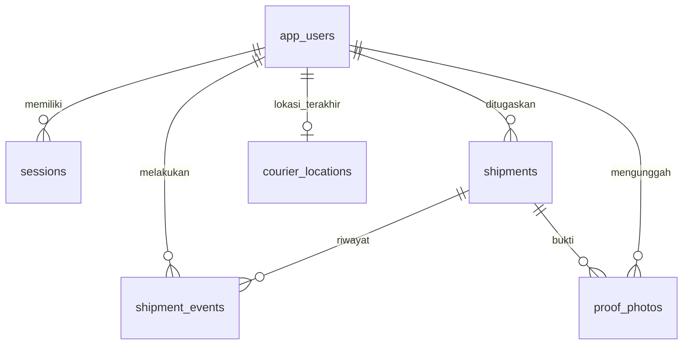

# Struktur PostgreSQL

Sumber skema: `backend/migrations/001_initial.sql`. Backend mengakses PostgreSQL melalui `pg` dengan pool maksimum 5 koneksi. Flutter hanya menggunakan API HTTPS; URL/password database tidak dibundel ke APK.

| Tabel | Isi |
|---|---|
| `app_users` | Profil, email unik, role admin/kurir, status aktif, hash scrypt |
| `sessions` | Digest token login, relasi pengguna, batas waktu sesi |
| `shipments` | Resi unik, FK kurir, status, waktu server, revisi, detail/proof JSONB |
| `courier_locations` | Posisi terakhir setiap kurir, waktu GPS/server, status tracking dan revisi |
| `shipment_events` | Riwayat status/perubahan, aktor dan waktu server |
| `proof_photos` | Tiga kategori foto; bytes BYTEA, MIME, pengiriman, kurir, dan logical path unik |
| `schema_migrations` | Versi skema yang sudah dipasang |



## Jaminan konsistensi

Resi mempunyai UNIQUE constraint dan format diperiksa server/database. Penugasan menggunakan foreign key ke pengguna. Status dibatasi pada Pending, Proses, Tertunda, Selesai, Retur dan Batal. Perubahan data aplikasi dijalankan dalam transaksi dengan advisory lock untuk skala demonstrasi skripsi; versi record juga diperiksa agar perubahan lama tidak menimpa perubahan baru.

Riwayat ditulis pada transaksi yang sama dengan pengiriman. Klien tidak dapat mengubah role sendiri, menulis riwayat, menyelesaikan pengiriman tanpa foto, atau mengubah pengiriman selesai. Penonaktifan kurir yang masih memiliki tugas Pending/Proses ditolak.

## Foto di database

`proof_photos.bytes` memakai BYTEA (maksimum 5 MB per foto). Foto harus JPG/PNG dan path harus sesuai pengguna, pengiriman serta kategori receipt/recipient/parcel. Foto yang sudah ada tidak dapat ditimpa; retry identik diperbolehkan. Penyelesaian memeriksa keberadaan ketiga baris foto. Pembacaan foto melewati API berautentikasi, dengan izin admin atau kurir yang berhak.

Pilihan BYTEA menyatukan penyimpanan untuk skripsi berukuran kecil dan tidak membutuhkan bucket tambahan. Untuk volume pengiriman besar, berkas dapat dipindah ke object storage sementara metadata tetap di PostgreSQL; itu tidak dilakukan pada migrasi ini.

## Pelacakan

Kurir mengirim latitude/longitude/akurasi/fixAt ketika memiliki tugas Proses. Server menggunakan jamnya sendiri untuk updatedAt, menolak koordinat invalid dan sampel yang lebih tua dari posisi terakhir. Admin mengambil snapshot melalui API setiap 5 detik. Jika koneksi klien gagal, posisi terakhir tetap ada dengan metadata cache; posisi lama tidak diberi timestamp sinkron baru.

Berhenti mengantar mempertahankan koordinat terakhir dengan isTracking false. Force-stop/izin GPS/internet/optimasi baterai tetap harus diuji pada HP; database tidak dapat memaksa OS mengirim GPS.

## Pemeriksaan SQL contoh

Jalankan hanya pada console database yang benar:

```sql
SELECT resi, status, courier_id, created_at FROM shipments ORDER BY created_at DESC;
SELECT kind, content_type, octet_length(bytes) AS byte_count FROM proof_photos;
SELECT courier_id, latitude, longitude, data->>'isTracking' AS tracking FROM courier_locations;
SELECT version, applied_at FROM schema_migrations;
```

Tidak ada password plaintext pada tabel pengguna. Token sesi juga disimpan sebagai hash; kredensial bootstrap hanya berada pada Railway Variables dan berkas lokal yang diabaikan Git.
